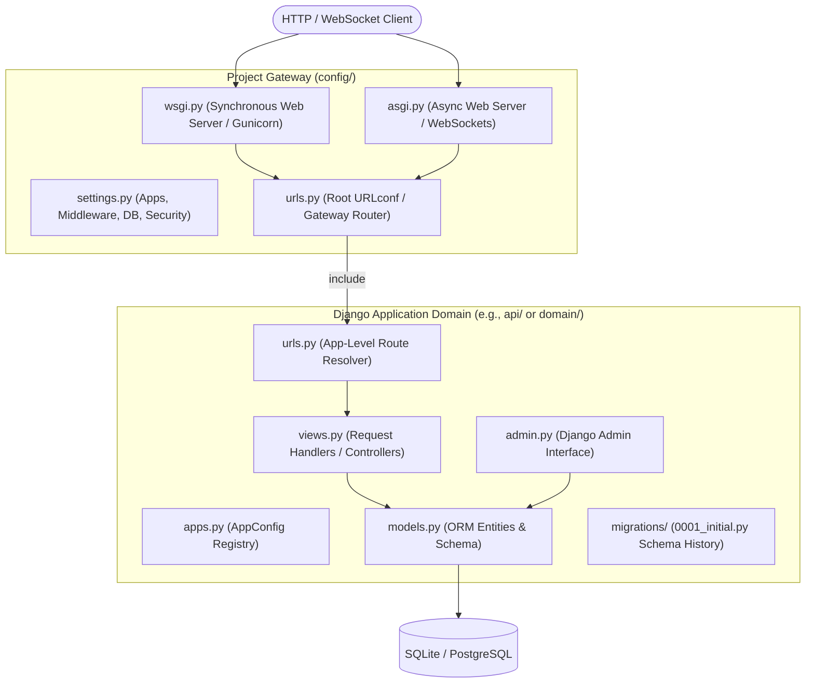

# Canonical Django Directory Structure & Architecture Guide

A definitive architectural reference for Django projects, enterprise scaling patterns, and the domain structure across all 25 applications in this repository.

---

## 1. Executive Summary & Architecture

Django follows a **Model-View-Template (MVT)** architectural paradigm. At the system level, a Django deployment consists of two foundational tiers:
1. **The Project Root / Configuration Package** (`config/` or `<project_name>/`): Acts as the routing gateway, configuration center, and WSGI/ASGI application entrypoint.
2. **Pluggable Application Packages** (`api/`, `catalog/`, `users/`, etc.): Modular domains housing database models, business logic, administration hooks, and request-response handlers.



---

## 2. The Canonical Django File-by-File Blueprint

Every standard Django repository contains the following core files:

```text
my_django_project/
├── manage.py                    # CLI management runner
├── db.sqlite3                   # Development SQLite database
├── pytest.ini                   # Test runner configuration
├── requirements.txt             # Pinned Python dependencies
├── config/                      # Project configuration package
│   ├── __init__.py              # Marks package as importable
│   ├── settings.py              # Central project configuration
│   ├── urls.py                  # Top-level URLconf
│   ├── wsgi.py                  # WSGI entrypoint for WSGI servers
│   └── asgi.py                  # ASGI entrypoint for async servers
└── api/                         # Pluggable application package
    ├── __init__.py              # Package marker
    ├── apps.py                  # Django AppConfig definition
    ├── models.py                # Django ORM data models
    ├── admin.py                 # Django admin site registrations
    ├── migrations/              # Database schema migrations
    │   ├── __init__.py
    │   └── 0001_initial.py      # Autogenerated schema migration
    ├── views.py                 # HTTP request handlers
    ├── urls.py                  # App URL routing
    └── middleware.py            # Custom request/response middleware
```

### 2.1 File Responsibilities

| File | Responsibility | Critical Snippet / Pattern |
|------|----------------|----------------------------|
| [`manage.py`](file:///home/singhvi28/Desktop/debugging-practice/debugging-practice-django/manage.py) | CLI entrypoint that sets `DJANGO_SETTINGS_MODULE` and delegates commands to `django.core.management`. | `execute_from_command_line(sys.argv)` |
| `config/wsgi.py` | Web Server Gateway Interface callable for production servers (Gunicorn, uWSGI, Nginx). | `application = get_wsgi_application()` |
| `config/asgi.py` | Asynchronous Server Gateway Interface for async servers (Uvicorn, Daphne) supporting WebSockets and HTTP/2. | `application = get_asgi_application()` |
| `config/settings.py` | Declares installed applications, middleware pipeline, database engines, security keys, and templates. | `INSTALLED_APPS`, `MIDDLEWARE`, `DATABASES`, `WSGI_APPLICATION` |
| `config/urls.py` | Master URL router; delegates route namespaces to specific apps via `include()`. | `path("api/", include("api.urls"))` |
| `api/apps.py` | App configuration class subclassing `django.apps.AppConfig`. Manages app initialization and signals. | `class ApiConfig(AppConfig): name = "api"` |
| `api/models.py` | Python classes subclassing `models.Model` mapped directly to relational database tables. | `class Product(models.Model): ...` |
| `api/admin.py` | Registers models with `django.contrib.admin` for an automatic web-based administrative CRUD interface. | `@admin.register(Product)` |
| `api/migrations/` | Version-controlled Python scripts tracking every change to model definitions over time. | Generated via `python manage.py makemigrations` |
| `api/views.py` | Business controllers that receive `HttpRequest` and return `HttpResponse` or `JsonResponse`. | `def get_item(request, item_id): ...` |

---

## 3. Production & Enterprise Django Architecture

In high-scale enterprise applications, placing all code into a flat `views.py` or single `models.py` causes tight coupling. Industry standard practice organizes Django code using the **Two-Tier Layout** and the **Service/Selector Pattern**:

```text
enterprise_project/
├── .github/                     # CI/CD workflows
├── docker/                      # Dockerfile, docker-compose.yml
├── docs/                        # Architecture decision records (ADRs)
├── scripts/                     # Automation & migration scripts
├── pyproject.toml               # Poetry / uv / pip-tools specification
├── src/                         # Python root (prevents top-level import pollution)
│   ├── manage.py
│   ├── config/                  # Project configuration
│   │   ├── __init__.py
│   │   ├── urls.py
│   │   ├── wsgi.py
│   │   ├── asgi.py
│   │   └── settings/            # Multi-environment split settings
│   │       ├── __init__.py
│   │       ├── base.py          # Shared apps, middleware, password validators
│   │       ├── local.py         # DEBUG=True, console email backend
│   │       ├── production.py    # Strict SSL, Sentry, Redis cache, Postgres
│   │       └── test.py          # In-memory SQLite, MD5 password hasher (fast)
│   └── apps/                    # Domain-driven modular applications
│       ├── core/                # Shared base models (TimeStampedModel), pagination
│       ├── authentication/      # Custom User model, JWT auth, permission classes
│       └── billing/             # Isolated domain app
│           ├── __init__.py
│           ├── apps.py
│           ├── admin.py
│           ├── urls.py
│           ├── models/          # Split models package
│           │   ├── __init__.py
│           │   ├── invoice.py
│           │   └── subscription.py
│           ├── api/             # DRF views and serializers
│           │   ├── serializers.py
│           │   └── views.py
│           ├── services/        # Business logic & mutations (CUD)
│           │   └── process_payment.py
│           ├── selectors/       # Pure database queries & filters (Read)
│           │   └── get_active_subscriptions.py
│           ├── tasks/           # Asynchronous Celery worker tasks
│           └── tests/           # Dedicated test suite
│               ├── factories.py # FactoryBoy model fixtures
│               └── test_services.py
```

### Services vs. Selectors Pattern
- **`services/`**: Functions responsible for **business mutations** (creating orders, charging credit cards, state transitions, sending transactional emails). Always wrapped in `transaction.atomic()`.
- **`selectors/`**: Functions responsible for **reading from the database**. They encapsulate complex ORM queries, annotations, `select_related`, and `prefetch_related` so views never execute raw queries.

---

## 4. Domain Inventory: All 25 Repositories

All 25 domains in this workspace have been upgraded with authentic Django ORM models, admin registrations, and initial database migrations:

| # | Repository | Core Domain | ORM Models (`api/models.py`) | Admin Classes (`api/admin.py`) |
|---|------------|-------------|------------------------------|--------------------------------|
| 01 | `01-movie-catalog` | Movies & Reviews | `Movie`, `Review`, `Watchlist` | `MovieAdmin`, `ReviewAdmin`, `WatchlistAdmin` |
| 02 | `02-bookstore` | Books & Shopping Cart | `Book`, `Cart`, `CartItem` | `BookAdmin`, `CartAdmin`, `CartItemAdmin` |
| 03 | `03-task-manager` | Projects & Tasks | `Project`, `Task` | `ProjectAdmin`, `TaskAdmin` |
| 04 | `04-recipe-box` | Recipes & Ingredients | `Recipe`, `Ingredient` | `RecipeAdmin`, `IngredientAdmin` |
| 05 | `05-blog-platform` | Posts & Comments | `Post`, `Comment` | `PostAdmin`, `CommentAdmin` |
| 06 | `06-inventory` | Stock & Product Moves | `Product`, `StockMove` | `ProductAdmin`, `StockMoveAdmin` |
| 07 | `07-music-playlists`| Tracks & Playlists | `Track`, `Playlist` | `TrackAdmin`, `PlaylistAdmin` |
| 08 | `08-event-tickets` | Events & Ticketing | `Event`, `Ticket` | `EventAdmin`, `TicketAdmin` |
| 09 | `09-course-enroll` | Courses & Enrollments | `Course`, `Enrollment` | `CourseAdmin`, `EnrollmentAdmin` |
| 10 | `10-order-service` | Products & Order Processing | `Product`, `Order`, `OrderItem` | `ProductAdmin`, `OrderAdmin`, `OrderItemAdmin` |
| 11 | `11-library-loans` | Library Books & Lending | `Book`, `Loan` | `BookAdmin`, `LoanAdmin` |
| 12 | `12-hotel-reservations`| Rooms & Bookings | `Room`, `Reservation` | `RoomAdmin`, `ReservationAdmin` |
| 13 | `13-expense-reports`| Reports & Expense Items | `ExpenseReport`, `LineItem` | `ExpenseReportAdmin`, `LineItemAdmin` |
| 14 | `14-forum-threads` | Discussion Threads & Replies | `Thread`, `Reply` | `ThreadAdmin`, `ReplyAdmin` |
| 15 | `15-file-metadata` | File Uploads & Tags | `FileRecord`, `Tag` | `FileRecordAdmin`, `TagAdmin` |
| 16 | `16-subscription-billing`| Plans & Billing Subscriptions| `Plan`, `Subscription` | `PlanAdmin`, `SubscriptionAdmin` |
| 17 | `17-appointment-scheduler`| Doctor / Client Appointments| `Provider`, `Appointment` | `ProviderAdmin`, `AppointmentAdmin` |
| 18 | `18-loyalty-points` | Reward Points Ledger | `Account`, `LedgerEntry` | `AccountAdmin`, `LedgerEntryAdmin` |
| 19 | `19-notification-inbox`| Notification Feed | `Notification` | `NotificationAdmin` |
| 20 | `20-warehouse-transfers`| Stock Logistics & Transfers| `Location`, `Transfer` | `LocationAdmin`, `TransferAdmin` |
| 21 | `21-marketplace-checkout`| E-Commerce Checkout | `Product`, `Cart`, `CartLine`, `Order` | `ProductAdmin`, `CartAdmin`, `CartLineAdmin`, `OrderAdmin` |
| 22 | `22-project-board` | Kanban Tasks & Concurrency | `Project`, `Task` | `ProjectAdmin`, `TaskAdmin` |
| 23 | `23-delivery-tracking`| Package State Machine | `Shipment`, `Checkpoint` | `ShipmentAdmin`, `CheckpointAdmin` |
| 24 | `24-media-processing`| Transcoding Job Queue | `MediaJob`, `MediaAsset` | `MediaJobAdmin`, `MediaAssetAdmin` |
| 25 | `25-expense-approvals`| Multi-Tier Approval Workflows| `Expense`, `ApprovalStep` | `ExpenseAdmin`, `ApprovalStepAdmin` |

---

## 5. Django Framework Source Code Architecture (`django/django`)

For deeper understanding of how the Django framework itself is organized under the hood on GitHub / PyPI:

```text
django/
├── conf/                        # Global settings, project/app templates
│   ├── app_template/            # Template for 'startapp'
│   ├── project_template/        # Template for 'startproject'
│   └── global_settings.py       # Default framework settings
├── contrib/                     # Bundled "batteries-included" apps
│   ├── admin/                   # Automatic admin interface
│   ├── auth/                    # User authentication and permissions
│   ├── contenttypes/            # Generic model relationships
│   ├── messages/                # Cookie- and session-based flash messaging
│   ├── sessions/                # Anonymous and user session storage
│   ├── staticfiles/             # Collectstatic and static asset serving
│   ├── postgres/                # PostgreSQL-specific fields & indexes
│   └── sitemaps/                # XML sitemap generator
├── core/                        # Low-level framework machinery
│   ├── checks/                  # System check framework (manage.py check)
│   ├── exceptions/              # Framework-wide exceptions (ObjectDoesNotExist)
│   ├── files/                   # File handling, uploads, and storages
│   ├── handlers/                # WSGIHandler and ASGIHandler
│   ├── mail/                    # Email backends (SMTP, console, in-memory)
│   ├── management/              # Base management commands (runserver, migrate)
│   └── paginator/               # Pagination primitives
├── db/                          # Database layer
│   ├── backends/                # SQLite, PostgreSQL, MySQL, Oracle engines
│   ├── migrations/              # Migration recorder, autodetector, executor
│   └── models/                  # Fields, QuerySet, Model base class, expressions
├── dispatch/                    # Observer pattern (Django Signals / Signal dispatcher)
├── forms/                       # HTML form generation and data validation
├── http/                        # HttpRequest, HttpResponse, JsonResponse
├── middleware/                  # Built-in middlewares (Security, Common, CSRF)
├── template/                    # Django Template Language (DTL) parser and tags
├── urls/                        # URL resolver, path(), include(), converters
├── utils/                       # Internal helpers (functional, text, timezone, crypto)
└── views/                       # Generic Class-Based Views (ListView, DetailView)
```

---

## 6. Essential Django CLI Commands

From inside any of the 25 upgraded repository directories:

```bash
# 1. Run Django system integrity check
python3 manage.py check

# 2. Inspect or generate database migrations
python3 manage.py makemigrations api

# 3. Apply migrations to the local SQLite database
python3 manage.py migrate

# 4. Open the interactive Django shell (loads models and settings)
python3 manage.py shell

# 5. Start the local development web server
python3 manage.py runserver

# 6. Execute the test suite
pytest -v
```
