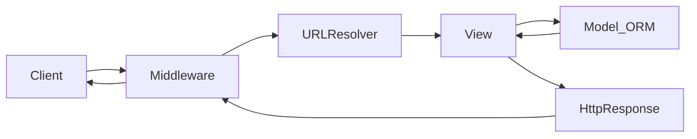

# Django Development + Backend Interview Guide

Theory and code for Django interviews and day-to-day backend work: **MVC/MVT**, core Django, and **Django REST Framework (DRF)**, with snippets you can talk through out loud.

This guide is **not** a lab spoiler sheet. For repository debugging drills, use [STUDY-GUIDE.md](STUDY-GUIDE.md). For OA bug patterns, see [../CONTEXT.md](../CONTEXT.md).

| Doc | Use for |
|-----|---------|
| [STUDY-GUIDE.md](STUDY-GUIDE.md) | Timed OA-style debugging (plain Django views + Client) |
| This guide | Architecture, ORM, DRF, verbal interview answers |
| [01–10](README.md) / [buglyst-medium/](buglyst-medium/) | Hands-on practice |

**Stack note:** Labs in this folder use plain Django (`JsonResponse`, custom middleware, in-memory stores). DRF is taught here because interviews and production APIs almost always expect it.

---

## 1. Orientation

In a backend interview you are usually asked to:

1. Explain how a request becomes a response (architecture).
2. Model data and query it efficiently (ORM).
3. Design a REST API (status codes, serializers, auth).
4. Debug broken behavior under tests (same skills as the labs).

Say this when asked “What is Django?”:

> Django is a batteries-included Python web framework. It uses an MVT pattern: models for data, views for request logic, templates (or JSON serializers) for presentation. URLconf routes requests. The ORM and admin ship with the framework; for APIs we typically add Django REST Framework.

---

## 2. Architecture theory

### 2.1 MVC vs Django MVT

Classic **MVC** (Model–View–Controller):

| Piece | Role |
|-------|------|
| **Model** | Data + business rules |
| **View** | Presentation (UI) |
| **Controller** | Receives input, updates model, picks view |

Django’s **MVT** (Model–Template–View):

| Piece | Role | Maps to MVC |
|-------|------|-------------|
| **Model** | ORM classes, DB schema | Model |
| **Template** | HTML presentation (optional for APIs) | View |
| **View** | Callable that takes `request`, returns `response` | Controller (+ some view logic) |
| **URLconf** | Maps paths to views | Front-controller routing |

Interview answer:

> Django calls the request handler a *view*, which is closer to a controller. Templates are the presentation layer. For JSON APIs, serializers (DRF) replace templates.



### 2.2 Request lifecycle

```text
HTTP request
  → Middleware (top of MIDDLEWARE first inbound)
  → URL resolver (ROOT_URLCONF → include → path)
  → View (FBV / CBV / DRF viewset action)
  → Model / ORM / cache / external service
  → Response object
  → Middleware (outbound, reverse order)
  → Client
```

Ask yourself when debugging: **Did the request reach the view?** If not, look at middleware or URLconf first.

### 2.3 Separation of concerns

| Layer | Typical files | Responsibility |
|-------|---------------|----------------|
| Settings | `settings.py` | Apps, DB, middleware, secrets |
| Routing | `urls.py` | Path → view |
| Domain data | `models.py` | Schema + constraints |
| HTTP logic | `views.py` | Auth checks, orchestration, status codes |
| Serialization | `serializers.py` (DRF) | Validate + shape JSON |
| Business helpers | `services.py` / store | Non-HTTP rules |

### 2.4 Stateless HTTP and REST

- Each request carries what the server needs (auth header, body, ids).
- Resources are nouns (`/movies`, `/movies/1`); verbs are HTTP methods.
- Idempotent methods: `GET`, `PUT`, `DELETE` (same effect if repeated); `POST` usually creates.

Common status codes (say these precisely in interviews):

| Code | Meaning |
|------|---------|
| `200` | OK |
| `201` | Created |
| `204` | No content (often DELETE) |
| `400` | Bad request (client input) |
| `401` | Unauthenticated |
| `403` | Authenticated but forbidden |
| `404` | Not found |
| `405` | Method not allowed |
| `409` | Conflict (duplicate, sold out) |
| `422` | Validation failed (common with DRF) |
| `500` | Unhandled server error |

---

## 3. Core Django

### 3.1 Project vs app

```bash
django-admin startproject config .
python manage.py startapp movies
```

```text
config/
  settings.py
  urls.py
  wsgi.py / asgi.py
movies/
  models.py
  views.py
  urls.py
  admin.py
  migrations/
manage.py
```

Register apps:

```python
# config/settings.py
INSTALLED_APPS = [
    "django.contrib.admin",
    "django.contrib.auth",
    "django.contrib.contenttypes",
    "django.contrib.sessions",
    "django.contrib.messages",
    "django.contrib.staticfiles",
    "movies",
]
```

Root URLconf:

```python
# config/urls.py
from django.contrib import admin
from django.urls import include, path

urlpatterns = [
    path("admin/", admin.site.urls),
    path("api/", include("movies.urls")),
]
```

### 3.2 Models and the ORM

```python
# movies/models.py
from django.db import models


class Movie(models.Model):
    title = models.CharField(max_length=200)
    year = models.PositiveIntegerField()
    created_at = models.DateTimeField(auto_now_add=True)

    class Meta:
        ordering = ["-year"]

    def __str__(self) -> str:
        return self.title


class Review(models.Model):
    movie = models.ForeignKey(Movie, on_delete=models.CASCADE, related_name="reviews")
    rating = models.PositiveSmallIntegerField()
    text = models.TextField(blank=True)
```

Migrations:

```bash
python manage.py makemigrations
python manage.py migrate
```

Interview line:

> `makemigrations` detects model changes and writes migration files; `migrate` applies them to the database. Never edit applied migrations casually—add a new migration instead.

#### QuerySet essentials

```python
Movie.objects.all()
Movie.objects.filter(year__gte=2010)
Movie.objects.exclude(title="")
Movie.objects.get(pk=1)                 # DoesNotExist / MultipleObjectsReturned
Movie.objects.filter(title__icontains="dark")
Movie.objects.create(title="Dune", year=2021)
movie.save()
movie.delete()
```

#### N+1 and how to fix it

```python
# BAD — one query for movies, then one per movie for reviews
for movie in Movie.objects.all():
    print(movie.reviews.count())

# GOOD — FK forward / reverse with joins or prefetch
movies = Movie.objects.prefetch_related("reviews")
for movie in movies:
    print(movie.reviews.count())

# select_related: forward FK / OneToOne (SQL JOIN)
Review.objects.select_related("movie").filter(rating=5)
```

| Helper | Use when |
|--------|----------|
| `select_related` | Single-valued relation (FK, OneToOne) |
| `prefetch_related` | Multi-valued (reverse FK, M2M); separate query + stitch |

### 3.3 Views: FBV and CBV

**Function-based view (FBV)** — same style as this repo’s labs:

```python
import json
from django.http import HttpResponse, JsonResponse
from django.views.decorators.csrf import csrf_exempt
from django.views.decorators.http import require_http_methods

from movies.models import Movie


@csrf_exempt
@require_http_methods(["GET", "POST"])
def movie_list(request):
    if request.method == "GET":
        search = request.GET.get("search")
        qs = Movie.objects.all()
        if search:
            qs = qs.filter(title__icontains=search)
        data = [{"id": m.id, "title": m.title, "year": m.year} for m in qs]
        return JsonResponse(data, safe=False)

    body = json.loads(request.body.decode() or "{}")
    movie = Movie.objects.create(title=body["title"], year=body["year"])
    return JsonResponse(
        {"id": movie.id, "title": movie.title, "year": movie.year},
        status=201,
    )


@require_http_methods(["GET"])
def movie_detail(request, movie_id: int):
    try:
        movie = Movie.objects.get(pk=movie_id)
    except Movie.DoesNotExist:
        return JsonResponse({"detail": "Not found"}, status=404)
    return JsonResponse({"id": movie.id, "title": movie.title, "year": movie.year})
```

**Class-based view (CBV)** sketch:

```python
from django.views import View


class MovieListView(View):
    def get(self, request):
        ...

    def post(self, request):
        ...
```

Notes for interviews:

- Browser form POSTs need CSRF; APIs often use token auth and exempt CSRF or use DRF.
- One URL path → one view callable. Combine methods in one FBV or use CBV/`ViewSet`.
- Lists need `JsonResponse(..., safe=False)`.

### 3.4 URLconf

```python
# movies/urls.py
from django.urls import path

from movies import views

urlpatterns = [
    path("movies", views.movie_list),
    path("movies/<int:movie_id>", views.movie_detail),
]
```

Converters: `<int:pk>`, `<str:slug>`, `<uuid:id>`, `<path:subpath>`.

`APPEND_SLASH`: if `True` (default), Django may redirect `/movies` → `/movies/`. API tests often expect exact paths—know which mode the project uses.

### 3.5 Middleware

```python
from django.http import JsonResponse

VALID_TOKEN = "secret-token"


class BearerAuthMiddleware:
    def __init__(self, get_response):
        self.get_response = get_response

    def __call__(self, request):
        if request.method == "POST" and request.path.startswith("/api/movies"):
            auth = request.headers.get("Authorization", "")
            if not auth.startswith("Bearer ") or auth.removeprefix("Bearer ").strip() != VALID_TOKEN:
                return JsonResponse({"detail": "Unauthorized"}, status=401)
        return self.get_response(request)
```

```python
MIDDLEWARE = [
    "django.middleware.security.SecurityMiddleware",
    "django.middleware.common.CommonMiddleware",
    "movies.middleware.BearerAuthMiddleware",
]
```

Interview line:

> Middleware wraps the whole request/response. On the way in, the first listed middleware runs first; on the way out, order reverses. To continue, call `get_response(request)`. Returning early short-circuits the view.

### 3.6 Settings you should name in interviews

```python
DEBUG = False                    # never True in production
ALLOWED_HOSTS = ["api.example.com"]
DATABASES = {
    "default": {
        "ENGINE": "django.db.backends.postgresql",
        "NAME": "app",
        "USER": "app",
        "PASSWORD": "...",
        "HOST": "db",
        "PORT": "5432",
    }
}
SECRET_KEY = "..."               # from env, not committed
```

### 3.7 Auth basics (bridge to DRF)

| Mechanism | Typical use |
|-----------|-------------|
| Session + cookies | Django admin, server-rendered sites |
| Token / JWT in `Authorization` | Mobile / SPA / public APIs |
| `django.contrib.auth.models.User` | Built-in user; extend via profile or custom user model |

```python
from django.contrib.auth import authenticate, login

user = authenticate(request, username="ada", password="...")
if user is not None:
    login(request, user)  # sets session
```

For APIs, prefer DRF authentication classes over hand-rolled session logic.

---

## 4. Django REST Framework

### 4.1 Why DRF instead of raw `JsonResponse`?

| Concern | Plain Django | DRF |
|---------|--------------|-----|
| Validation | Manual | Serializers |
| Content negotiation | Manual | Built-in |
| Browsable API | No | Yes |
| Auth / permissions | DIY | Pluggable classes |
| Viewsets + routers | DIY urls | Convention |
| Pagination / filtering | DIY | Mixins + settings |

Interview line:

> DRF sits on Django. Serializers validate and transform data; views/viewsets handle HTTP; routers generate URL patterns; permissions and authentication are declarative.

Install (real projects):

```text
djangorestframework
```

```python
INSTALLED_APPS = [..., "rest_framework"]
```

### 4.2 Serializers

```python
from rest_framework import serializers
from movies.models import Movie, Review


class ReviewSerializer(serializers.ModelSerializer):
    class Meta:
        model = Review
        fields = ["id", "rating", "text"]


class MovieSerializer(serializers.ModelSerializer):
    reviews = ReviewSerializer(many=True, read_only=True)

    class Meta:
        model = Movie
        fields = ["id", "title", "year", "reviews"]

    def validate_year(self, value: int) -> int:
        if value < 1888:
            raise serializers.ValidationError("Year looks invalid.")
        return value


# Non-model / input-only
class MovieCreateSerializer(serializers.Serializer):
    title = serializers.CharField(max_length=200)
    year = serializers.IntegerField(min_value=1888)

    def create(self, validated_data):
        return Movie.objects.create(**validated_data)
```

Flow:

```python
ser = MovieCreateSerializer(data=request.data)
ser.is_valid(raise_exception=True)  # → 400 with error body
movie = ser.save()
```

### 4.3 APIView, generics, viewsets

**APIView** — explicit control:

```python
from rest_framework.views import APIView
from rest_framework.response import Response
from rest_framework import status


class MovieListCreate(APIView):
    def get(self, request):
        qs = Movie.objects.all()
        return Response(MovieSerializer(qs, many=True).data)

    def post(self, request):
        ser = MovieSerializer(data=request.data)
        ser.is_valid(raise_exception=True)
        ser.save()
        return Response(ser.data, status=status.HTTP_201_CREATED)
```

**Generics** — less boilerplate:

```python
from rest_framework import generics


class MovieListCreateView(generics.ListCreateAPIView):
    queryset = Movie.objects.all()
    serializer_class = MovieSerializer


class MovieDetailView(generics.RetrieveUpdateDestroyAPIView):
    queryset = Movie.objects.all()
    serializer_class = MovieSerializer
```

**ViewSet / ModelViewSet** — CRUD in one class:

```python
from rest_framework import viewsets


class MovieViewSet(viewsets.ModelViewSet):
    queryset = Movie.objects.all().prefetch_related("reviews")
    serializer_class = MovieSerializer
```

Actions on `ModelViewSet`: `list`, `create`, `retrieve`, `update`, `partial_update`, `destroy`.

Custom action:

```python
from rest_framework.decorators import action


class MovieViewSet(viewsets.ModelViewSet):
    queryset = Movie.objects.all()
    serializer_class = MovieSerializer

    @action(detail=True, methods=["post"])
    def publish(self, request, pk=None):
        movie = self.get_object()
        # ...
        return Response({"status": "published"})
```

### 4.4 Routers

```python
from django.urls import include, path
from rest_framework.routers import DefaultRouter

from movies.views import MovieViewSet

router = DefaultRouter()
router.register("movies", MovieViewSet, basename="movie")

urlpatterns = [
    path("api/", include(router.urls)),
]
```

Generated routes (trailing slash depends on settings):

| Method | Path | Action |
|--------|------|--------|
| GET | `/api/movies/` | list |
| POST | `/api/movies/` | create |
| GET | `/api/movies/{pk}/` | retrieve |
| PUT | `/api/movies/{pk}/` | update |
| PATCH | `/api/movies/{pk}/` | partial_update |
| DELETE | `/api/movies/{pk}/` | destroy |

### 4.5 Request and Response

```python
request.user          # authenticated user or AnonymousUser
request.auth          # token / credentials object
request.data          # parsed JSON/form (DRF)
request.query_params  # query string (prefer over request.GET in DRF)
Response(data, status=201)
```

### 4.6 Auth, permissions, throttling

```python
# settings.py
REST_FRAMEWORK = {
    "DEFAULT_AUTHENTICATION_CLASSES": [
        "rest_framework.authentication.TokenAuthentication",
        # "rest_framework_simplejwt.authentication.JWTAuthentication",
    ],
    "DEFAULT_PERMISSION_CLASSES": [
        "rest_framework.permissions.IsAuthenticatedOrReadOnly",
    ],
    "DEFAULT_PAGINATION_CLASS": "rest_framework.pagination.PageNumberPagination",
    "PAGE_SIZE": 20,
    "DEFAULT_THROTTLE_CLASSES": [
        "rest_framework.throttling.AnonRateThrottle",
        "rest_framework.throttling.UserRateThrottle",
    ],
    "DEFAULT_THROTTLE_RATES": {"anon": "100/day", "user": "1000/day"},
}
```

Per-view:

```python
from rest_framework.permissions import IsAuthenticated, AllowAny


class MovieViewSet(viewsets.ModelViewSet):
    permission_classes = [IsAuthenticated]
    # ...
```

Token sketch:

```bash
python manage.py migrate
# obtain token via obtain_auth_token view or create in shell
# Header: Authorization: Token <key>
# JWT often: Authorization: Bearer <access>
```

### 4.7 Filtering, search, ordering

```python
from rest_framework import filters


class MovieViewSet(viewsets.ModelViewSet):
    queryset = Movie.objects.all()
    serializer_class = MovieSerializer
    filter_backends = [filters.SearchFilter, filters.OrderingFilter]
    search_fields = ["title"]
    ordering_fields = ["year", "title"]
```

```text
GET /api/movies/?search=dark&ordering=-year
```

For complex filters, `django-filter` + `DjangoFilterBackend` is a common interview mention.

### 4.8 Testing with DRF

```python
from rest_framework.test import APIClient
from rest_framework import status
import pytest


@pytest.mark.django_db
def test_create_movie():
    client = APIClient()
    client.credentials(HTTP_AUTHORIZATION="Token " + token.key)
    res = client.post("/api/movies/", {"title": "Dune", "year": 2021}, format="json")
    assert res.status_code == status.HTTP_201_CREATED
    assert res.data["title"] == "Dune"
```

Vs this repo’s labs: `django.test.Client` + `json.dumps` + `content_type="application/json"`. Same ideas; DRF’s `APIClient` parses `res.data` for you.

### 4.9 Mini end-to-end: movies API

```python
# models.py — Movie as above

# serializers.py
class MovieSerializer(serializers.ModelSerializer):
    class Meta:
        model = Movie
        fields = ["id", "title", "year"]

# views.py
class MovieViewSet(viewsets.ModelViewSet):
    queryset = Movie.objects.all()
    serializer_class = MovieSerializer
    search_fields = ["title"]
    filter_backends = [filters.SearchFilter]

# urls.py
router = DefaultRouter()
router.register("movies", MovieViewSet)
urlpatterns = [path("api/", include(router.urls))]
```

That is the interview “vertical slice”: model → serializer → viewset → router.

---

## 5. Interview questions and debugging crossover

### 5.1 Verbal answers (short)

**MVC vs MVT?**  
Django’s view ≈ controller; template ≈ classic view; URLconf routes.

**What are migrations?**  
Versioned schema changes derived from models; apply with `migrate`.

**`select_related` vs `prefetch_related`?**  
JOIN for single-valued relations vs separate query for multi-valued; both fight N+1.

**FBV vs CBV vs ViewSet?**  
FBV = explicit; CBV = reuse via inheritance; ViewSet + router = REST CRUD convention.

**PUT vs PATCH?**  
PUT replaces the resource; PATCH partial update. DRF maps both on viewsets.

**How do you secure an API?**  
HTTPS, auth (token/JWT), permissions, validation, rate limits, least privilege, no secrets in code.

**Transactions?**  

```python
from django.db import transaction

with transaction.atomic():
    order = Order.objects.create(...)
    Inventory.objects.select_for_update().get(pk=...).save()
```

**Signals?**  
Decoupled hooks (`post_save`, etc.). Powerful but easy to hide side effects—prefer explicit service calls when clarity matters.

**Idempotency?**  
Repeating the same request (e.g. payment with `Idempotency-Key`) should not double-charge; store request fingerprint → response.

### 5.2 Same bug shapes in DRF

The OA patterns in [../CONTEXT.md](../CONTEXT.md) still apply:

| Pattern | Plain Django | DRF-shaped form |
|---------|--------------|-----------------|
| Wrong status | `JsonResponse(..., status=200)` on create | Forgetting `status=HTTP_201_CREATED` |
| Missing 404 | Return `None` body | Missing `get_object()` / not using generics |
| Auth wall | Middleware never calls `get_response` | Permission class always denying; auth not configured |
| Wrong route/method | Bad `path` / `@require_http_methods` | Router not registered; `@action` method mismatch |
| Validation | Manual `400` | Serializer not `is_valid`; integrity error → 500 |
| N+1 | Loop on related | Viewset queryset without `select_related`/`prefetch_related` |

Practice recognition on [01–10](README.md) with [STUDY-GUIDE.md](STUDY-GUIDE.md), then explain the DRF equivalent in interviews.

---

## 6. Cheat sheets

### 6.1 Plain Django ↔ DRF

| Task | Plain Django | DRF |
|------|--------------|-----|
| Parse JSON body | `json.loads(request.body)` | `request.data` |
| Return JSON | `JsonResponse(data)` | `Response(data)` |
| List JSON | `JsonResponse(list, safe=False)` | `Response(serializer.data)` |
| Create status | `status=201` | `status.HTTP_201_CREATED` |
| Not found | Manual `404` JsonResponse | `get_object_or_404` / `get_object()` |
| Auth header tests | `headers={"Authorization": ...}` | `client.credentials(...)` |
| Query params | `request.GET` | `request.query_params` |

### 6.2 Lab `store.py` vs ORM

| In-memory store (labs) | Django ORM |
|------------------------|------------|
| `dict` keyed by id | `Model.objects` |
| `reset()` in tests | DB rollback / `django_db` fixture |
| Manual duplicate checks | DB constraints + serializer validation |
| `deepcopy` on read | QuerySet evaluation / fresh `get` |

### 6.3 Status codes (again, memorize)

`200` OK · `201` Created · `204` No content · `400` Bad input · `401` Auth missing · `403` Forbidden · `404` Missing · `405` Wrong method · `409` Conflict · `429` Throttled · `500` Server error

### 6.4 Commands

```bash
python manage.py startapp <name>
python manage.py makemigrations
python manage.py migrate
python manage.py createsuperuser
python manage.py runserver
pytest -v
```

---

## 7. How to study with this repo

1. Read sections 2–4 here until you can sketch MVT + a ModelViewSet on a whiteboard.
2. Drill [STUDY-GUIDE.md](STUDY-GUIDE.md) workflows on labs `01`–`10` (plain Django).
3. In mock interviews, narrate: “In production I’d use a ModelSerializer and ModelViewSet; the bug class is the same—wrong status / missing 404 / auth short-circuit.”
4. Optionally build a tiny DRF project locally (movies CRUD) to muscle-memory routers and `APIClient`.

Debugging rounds reward pattern recognition; interviews reward clear architecture answers. Django fluency is both.
